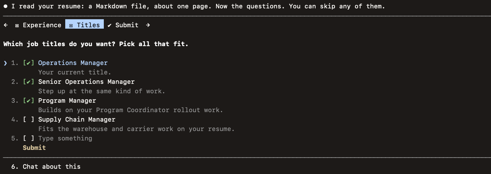
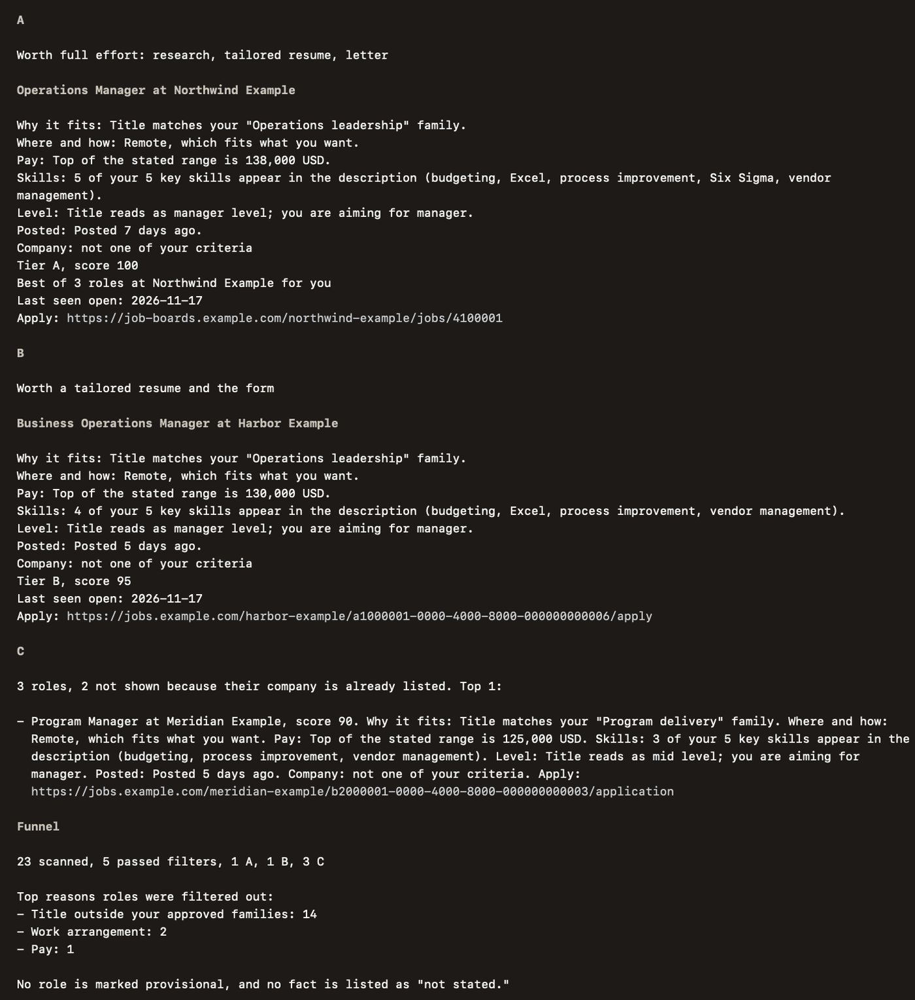
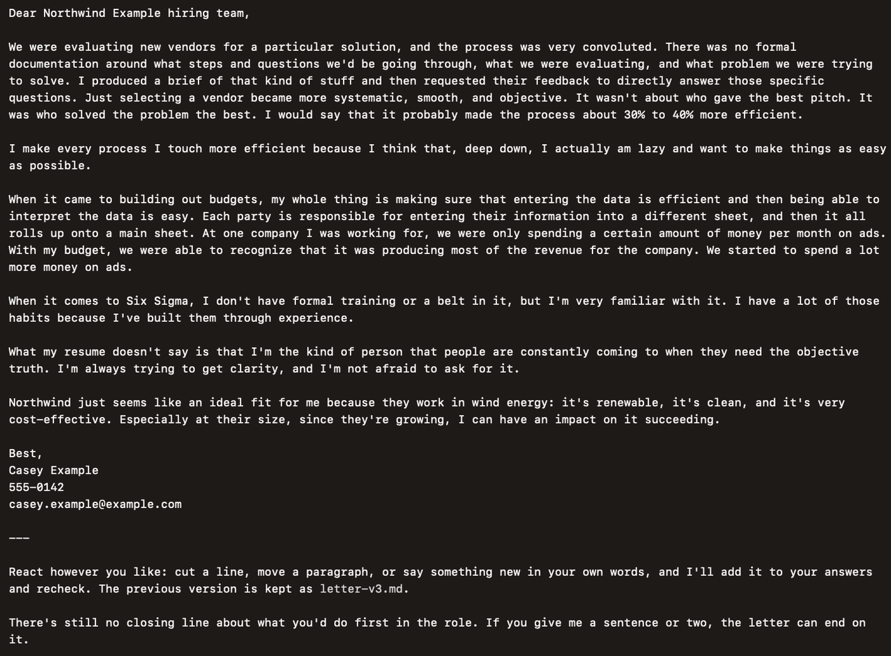

# job-search-prioritizer

[](https://github.com/adamNBurke/job-search-prioritizer/actions/workflows/ci.yml)

Rank open jobs against your own criteria and see which to apply to first. Works alongside [career-ops](https://github.com/career-ops-hq/career-ops).

## What it does

job-search-prioritizer is a [Claude Code](https://code.claude.com/docs) plugin for people looking for a job. You give it your resume and answer a short interview about the work you want. It counts, from real job postings, which job titles your skills fit. It then scans the public job boards of the companies you care about and ranks every open role into three plain-English tiers. A roles are the ones to apply to first, B roles are worth a tailored resume, and C roles are worth keeping in view. Every ranked role shows the reason first and a link to apply. You always apply yourself.

```text
  your resume
      |
  a short interview about the job you want
      |
  the job titles your skills fit
      |
  a scan of public job boards
      |
  A, B and C tiers, reason first, link to apply
      |
  a cover letter, at least 80% your own words (optional)
```

It runs only when you start it, and only inside Claude Code. Its skills rely on Claude Code features such as the [plugin marketplace](https://code.claude.com/docs/en/discover-plugins) and its pick-from-a-list questions, so it does not run in [Codex](https://github.com/openai/codex) or other AI agents. I use it on macOS, and automated checks run its tests and its skills in real terminals on macOS, Windows and Linux for every change. Reports from Windows and Linux users are welcome through the [Bug report form](https://github.com/adamNBurke/job-search-prioritizer/issues/new/choose).

## Why prioritization

In my own job search, there were far more open roles than I could read, posted across many job boards, and it was hard to tell which ones were a good fit for me and which employers would see me as a good fit for them. The roles were spread out, too. If I watched only a few boards, I missed things. If I tried to watch them all, it was overwhelming.

Applying to everything was not the answer. A good application still takes real time, with research on the company, a tailored resume and often a letter. With only so many hours in a day, sending applications everywhere and hoping something sticks spends those hours on roles that were never going to fit.

That is the point of prioritization. Collect roles from as many places as possible, judge every one against the same criteria, and put your limited time into the ones most worth it. Fit runs both ways, so a top-ranked role is no promise of a reply, and you still do the applying. The ranking tells you where to start, with the roles where your best applications have the best odds.

## Works best for

It reads the public job boards that companies host on [Greenhouse](https://www.greenhouse.com/), [Lever](https://www.lever.co/) and [Ashby](https://www.ashbyhq.com/). Those boards skew toward technology and mid-market companies. Large enterprises, hospitals and government agencies rarely use them, so a search aimed at those employers will find less. You can add the companies you care about by name, and you can paste any posting the scan missed, as text or as a link. It does not claim to cover every white-collar job.

## See a full run

A full run on a fictional job seeker, Casey, lives in the folder [`demo/casey-ops/`](demo/casey-ops/). It shows the interview answers, the ranked list and a cover letter in which at least 80% of the words are Casey's own (the check counted 7 of 348 body words as changed), with nothing real in it.

Start with the [walkthrough of the demo](demo/casey-ops/README.md). It says what each file shows and who wrote it: Casey, the agent, or the code.

Screenshots of the tool running in Claude Code on Casey's fictional data:







## What you need

- Claude Code, with a Claude account that can use it. Start at the [Claude Code docs](https://code.claude.com/docs).
- [uv](https://docs.astral.sh/uv/), a small tool that installs Python and the packages this plugin needs. If you do not have it:
  - On macOS or Linux, run `curl -LsSf https://astral.sh/uv/install.sh | sh`
  - On Windows, in PowerShell, run `powershell -ExecutionPolicy ByPass -c "irm https://astral.sh/uv/install.ps1 | iex"`
- [git](https://git-scm.com/), which Claude Code uses to download this plugin. To see whether you have it, run `git --version` in a terminal. If you do not have it:
  - On macOS, that same command offers to install Apple's command line tools, which include git. Accept, then run `git --version` again when the install finishes.
  - On Linux, install the `git` package with your package manager.
  - On Windows, install [Git for Windows](https://git-scm.com/downloads/win). Windows does not come with git.
- Your resume as a PDF, a Word document (DOCX) or a Markdown file.
- About 20 to 30 minutes in one sitting for the first run.

The first run downloads Python and three packages ([requests](https://pypi.org/project/requests/), [pypdf](https://pypi.org/project/pypdf/) and [python-docx](https://pypi.org/project/python-docx/), as listed at the top of [`scripts/jobsearch.py`](scripts/jobsearch.py)). That can take a minute, and it only happens once.

## Install

1. Make a new folder with any name you like, such as `job-search`, and [open Claude Code in it](https://code.claude.com/docs/en/quickstart).
2. Run these two commands there:

```text
/plugin marketplace add adamNBurke/job-search-prioritizer
/plugin install job-search-prioritizer@job-search-prioritizer
```

3. Run [`/job-search-prioritizer:start`](skills/start/SKILL.md). The first thing it needs from you is your resume.

The start skill asks you to pick a separate folder for your own job-search files (your resume copy, your answers, your ranked lists). That folder stays on your computer. Nothing in it is sent anywhere. A new folder in your home folder (the folder named after you) is a good choice, because Desktop and Documents can sync to the cloud.

## Turn on auto-update

Claude Code does not update a plugin from a third-party marketplace on its own until you ask it to. To turn it on:

1. In Claude Code, run `/plugin`.
2. Open the Marketplaces tab and select `job-search-prioritizer`.
3. Turn on auto-update.

Without auto-update you get new versions when you run `/plugin marketplace update job-search-prioritizer`. You receive a new copy only when a new version is released.

New features arrive in point releases. Next, I plan a results page of your A and B roles that opens in your browser, and a status for each role (saved, applied, interviewing and so on) that you set by talking to Claude.

## What it will not do

- It never submits an application. You apply, by hand, on the employer's own page.
- It makes no access of any kind to LinkedIn, including read-only. LinkedIn's [User Agreement](https://www.linkedin.com/legal/user-agreement) does not allow software that scrapes or copies LinkedIn (section 8.2), so reading it for you would put your LinkedIn account at risk (section 3.4). A LinkedIn link you paste is refused, and the tool asks for the text of the posting instead.
- It sends no telemetry and no analytics. There is no account and nothing is reported about you.

The only network calls it makes are these:

- Anonymous reads of public job-board pages (Greenhouse, Lever and Ashby) for the companies you scan.
- A link you paste yourself, when you ask it to read that posting.
- One check a day for a newer release, sent to GitHub. It carries nothing about you. You can turn it off by asking Claude to turn off update checks.

Your resume, answers and ranked lists stay in your own folder.

## Cover letters in your own words

The [letter skill](skills/letter/SKILL.md) (`/job-search-prioritizer:letter`) starts from a ranked role. It tells you first why the letter stays mostly in your words. Hiring managers read many letters an AI wrote, they all sound alike, and original words stand out. It asks you pointed questions about your own experience, and you answer in your own words. It suggests a greeting, a sign-off with the name, phone and email from your resume, and which story to open with, and you pick. It then cuts, reorders and tightens your answers. At least 80% of the letter body is your own words, and the skill is told never to add a fact about you that you did not give.

Two checks back this up, and both are code, not a promise from the model:

- A word check counts every word in the letter body that is not from your answers or the writing samples you saved, a suggested wording you picked included. It refuses to save the letter when those words are more than 20% of the body, and it names the sentences with the most changed words. Reordering and cutting cost nothing. It counts words, not facts, and it cannot judge whether your order and choices are good, so read the letter before you send it.
- A tone check names lines that sound machine-written, such as stock phrases, an em dash, or a colon right after a short lead-in. It only advises. You decide what to change.

## Using it with career-ops

[career-ops](https://github.com/career-ops-hq/career-ops) is a general-purpose job search plugin. This tool is a supplement to it, not a replacement, and neither depends on the other in code.

Each ranked list ends with a Send to career-ops block: your tier A roles as lines in the shape career-ops reads for its pipeline inbox. To use one, either paste a single apply link into a career-ops session, or add the lines under the Pending heading of career-ops' `data/pipeline.md` and run its pipeline mode.

## Claude usage

Measured on 2026-11-24 with Claude Code 2.1.331 and Claude Opus 5.5, on a Claude subscription. The dollar figures are the estimated cost that Claude Code's [`/usage` screen](https://code.claude.com/docs/en/costs) shows. On a Claude subscription you are not billed these amounts, so read them as a guide to how much of your plan's usage a run takes.

- One full `start` run, from the resume to a ranked list on live job boards, took $2.89, 63 requests and 5m 5s of API time.
- One cover letter took $1.20 to $1.42 across two measured runs, 21 to 30 requests and 1m 56s to 2m 31s of API time. The lower figure reused answers from the earlier run.

Your numbers will differ with the size of your search and with your own Claude Code setup, because every request re-reads the system prompt, the tools and any connected [MCP servers](https://code.claude.com/docs/en/mcp).

These figures are estimates. They are characters divided by four, a rough rule and not Claude's own token count.

What was counted is the demo workspace (Casey's fictional search, with 3 job boards and 23 postings) and one run of each skill. A run is the skill's own text with the install path filled in, the output of the commands it runs, and the files it tells Claude to read. The skill list row is every skill's name and description, which Claude carries in every session.

| Skill | Text budget (about tokens) | Before the lean pass | After the lean pass |
|-------|---------------------------:|---------------------:|--------------------:|
| Skill list, every session | 275 | 255 | 255 |
| `start` | 6,075 | 29,852 | 12,829 |
| `scan` | 2,475 | 4,806 | 4,547 |
| `review` | 1,225 | 5,259 | 2,942 |
| `letter` | 2,275 | 5,778 | 3,459 |
| `feedback` | 800 | 730 | 734 |
| `status` | 475 | 654 | 592 |

The text budget is the most a skill's own file (or the skill list) may hold at four characters per token, and a test fails any change that grows past it. The review row is a run with three marks. The start figure before the lean pass is from when the skill read all of [docs/data-files.md](docs/data-files.md), and the figure after also counts config/criteria.json, which the earlier count left out.

## Maintenance

I maintain this in my spare time. Bugs with a clear report are fixed in point releases (1.1, 1.2 and so on). Feature requests are read, not promised. No response time is promised, and a quiet issue is not a rejected one.

## Help and feedback

- Start with [SUPPORT](.github/SUPPORT.md) for where to ask and what never to paste.
- Report a bug or ask for a feature with the [issue forms](https://github.com/adamNBurke/job-search-prioritizer/issues/new/choose).
- Share a role you found or a letter you sent in the Wins category of [Discussions](https://github.com/adamNBurke/job-search-prioritizer/discussions).
- In Claude Code, [`/job-search-prioritizer:feedback`](skills/feedback/SKILL.md) drafts an issue for you to read and send yourself. It sends nothing on its own.
- To change the code yourself, read [CONTRIBUTING](CONTRIBUTING.md) before you open a pull request.
- To report a security problem, never open a public issue. Follow the [security policy](.github/SECURITY.md) to report it privately.
- Everyone who takes part here is expected to follow the [code of conduct](.github/CODE_OF_CONDUCT.md).
- If you are an AI agent, read [docs/for-agents.md](docs/for-agents.md).

## Credits

This repo was built with the tools below, and it runs on the packages and job board APIs listed here.

- [Claude Code](https://code.claude.com/docs), by Anthropic, is the tool this was built with and the one it runs inside.
- GSD, the package `@opengsd/gsd-core` by OpenGSD (MIT, [github.com/open-gsd/gsd-core](https://github.com/open-gsd/gsd-core)), is the planning, execution and verification workflow the build ran through.
- Ponytail, the package `@dietrichgebert/ponytail` by Dietrich Gebert (MIT, [github.com/DietrichGebert/ponytail](https://github.com/DietrichGebert/ponytail)), drove the whole-repo lean audit and the lean pass behind the smaller figures in Claude usage.
- [career-ops](https://github.com/career-ops-hq/career-ops) (MIT) is the job search plugin this one works alongside, and its pipeline format is what the Send to career-ops block follows.
- [uv](https://github.com/astral-sh/uv), by Astral, installs Python and runs the scripts.
- Three packages run the engine. [`requests`](https://pypi.org/project/requests/) (Apache-2.0) fetches job boards, [`pypdf`](https://pypi.org/project/pypdf/) (BSD-3-Clause) reads PDF resumes and [`python-docx`](https://pypi.org/project/python-docx/) (MIT) reads Word resumes.
- The [Greenhouse Job Board API](https://docs.greenhouse.io/job-board.html), the [Lever Postings API](https://github.com/lever/postings-api) and the [Ashby Job Postings API](https://developers.ashbyhq.com/docs/public-job-posting-api) are the public job board APIs the engine reads.
- Two packages check the work. [`pytest`](https://pypi.org/project/pytest/) (MIT) runs the tests and [`ruff`](https://pypi.org/project/ruff/) (MIT) lints the code.
- The [code of conduct](.github/CODE_OF_CONDUCT.md) is the [Contributor Covenant](https://www.contributor-covenant.org/), version 2.1.

## License

MIT. See [LICENSE](LICENSE).

## Author

Adam N. Burke. [LinkedIn](https://www.linkedin.com/in/adamnicholasb/)
